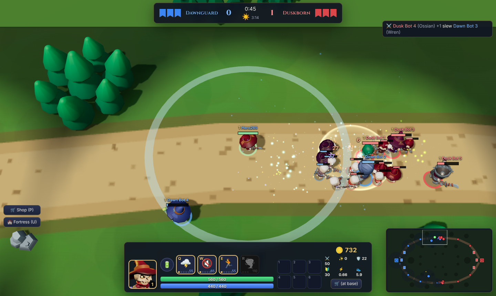

# Bannerfall

**A 2.5D online hero brawler with a tower-defense spine.** Pick one of 20 heroes. Your fortress's Bone Forge raises skeleton waves that march both lanes. Capture the enemy's banners to strip their fortress's shield, then raze it. Every kill and every banner pays gold, which you spend on equipment or on your base: forge upgrades, tower armories, and towers you build yourself.

Runs in the browser. One small Node server hosts rooms for you and your friends. Empty seats are filled by bots, and there is an offline practice mode.



## Features

- **20 heroes**, each with lore, a passive and four abilities (Q W E R). 6 roles, 3 difficulty levels. See [docs/HEROES.md](docs/HEROES.md).
- **Banners.** Each fortress flies three: the **War**, **Coin** and **Keep** banners. While all three fly, the fortress is immune. Capture them in order (outer tower → lane banner → Keep) to expose the core. Each banner gives its captors a different perk and pays gold.
- **Monster waves** every 30s from each Bone Forge. Upgrade the forge, or hire Bone Brutes for a lane.
- **Economy.** Gold from kills (with shutdown bounties), assists, last hits, towers, banners, jungle camps and the **Bone Colossus** boss. Spend it on **35 items** with recipes, on **6 team upgrades**, or on **4 kinds of buildable towers** on 6 build pads per team (the tower-defense layer).
- **Day/night cycle.** Nights shrink vision and make monsters richer.
- **Server-side fog of war.** You never receive what your team can't see.
- **Last Stand.** A fortress below 30% rallies its defenders once.
- **Bots** that lane, shop, defend banners, take objectives and fund upgrades.
- **Procedural sound effects** and **portraits rendered from the 3D models**.

## Quick start

Requirements: Node 20+.

```bash
npm install
npm run dev          # game server on :8787 + Vite client on :5173
# open http://localhost:5173
```

Production build (one process serves the client and the WebSocket):

```bash
npm run build
npm start            # http://localhost:8787  (PORT env var to change)
```

### Play with friends

1. Click **Create Online Room**, then share the 4-letter code or the invite link (`…/?room=CODE`).
2. Friends join, pick teams and heroes. The host chooses the team size; bots fill the empty seats.
3. If someone disconnects, a bot takes over their hero, and they can rejoin from the same browser.

To host for friends outside your network, deploy the container anywhere that runs Docker and supports WebSockets (Fly.io, Render, Railway, a VPS):

```bash
docker build -t bannerfall .
docker run -p 8787:8787 bannerfall
```

The server is in-memory and one process handles many rooms. The simulation costs about 0.6 ms per 20 Hz tick for a 5v5 match.

## Controls

| Input | Action |
|---|---|
| Right-click | Move / attack (hold to keep steering) |
| `A` + click | Attack-move |
| `Q` `W` `E` `R` | Abilities: hold to aim, release to cast. R unlocks at level 4 |
| `1`–`6` | Use item |
| `B` | Recall to base (4s channel) |
| `P` / `U` | Shop / Fortress (team upgrades, towers, mercenaries) |
| `Tab` | Scoreboard |
| `G` + click | Ping (`Shift` = danger) |
| `Enter` | Chat (`/t message` for team chat) |
| `Space` / `Y` | Center camera / toggle camera lock (edge-pan and middle-drag when unlocked) |
| Mouse wheel | Zoom |
| Arrow keys | Steer your hero directly |

## How it works

```
src/shared/          pure TypeScript, runs on the server AND in the browser (practice mode)
  types.ts           data schema: heroes, abilities, passives, items, and the Effect tree
  data/heroes/*.ts   20 heroes as data (no code per hero)
  data/items.ts      35 items as data
  sim/game.ts        authoritative simulation: 20 Hz, deterministic (seeded RNG)
  sim/effects.ts     interpreter for the Effect tree (damage, dash, projectile, zone, chain, summon…)
  sim/bots.ts        bot brains
  sim/nav.ts         grid A* pathfinding with string pulling
  map.ts units.ts upgrades.ts protocol.ts constants.ts
src/server/          Node http + ws: rooms, lobby, bot fill, reconnect, snapshot fan-out
src/client/          Three.js renderer, HUD, menus, WebAudio sfx
public/assets/       optimized KayKit models (CC0)
tools/               asset fetch/build pipeline, content validator, balance harness
tests/               headless bot matches, ability smoke tests, server tests
```

- **Authoritative server.** Clients send intents (`move`, `cast`, `buy`…). Every tick the server sends each player a snapshot filtered by their team's vision. Clients interpolate.
- **Content is data.** An ability is a list of effects, for example `projectile → on hit: damage + status(stun)`. Adding a hero means adding a file; `npm run validate` checks it. See [docs/BALANCE.md](docs/BALANCE.md) for the number ranges and [docs/MODELS.md](docs/MODELS.md) for models and weapons.

## Scripts

| Command | What it does |
|---|---|
| `npm run dev` | Server (watch) + client dev server |
| `npm run build` / `npm start` | Production build / run |
| `npm test` | Headless 10-bot match, ability smoke tests, server tests |
| `npm run validate` | Content validator for heroes and items |
| `npx tsx tools/balance.ts` | Balance harness (writes `docs/BALANCE-REPORT.md`) |
| `npm run assets:fetch` / `assets:build` | Re-download the KayKit packs and rebuild `public/assets` |

## Docs

- [docs/BRAINSTORM.md](docs/BRAINSTORM.md): gaps in the original brief, ideas, roadmap
- [docs/HEROES.md](docs/HEROES.md): the roster, lore and kits
- [docs/BALANCE.md](docs/BALANCE.md), [docs/BALANCE-REPORT.md](docs/BALANCE-REPORT.md): number ranges and measured balance
- [docs/MODELS.md](docs/MODELS.md): character models and weapon meshes

## Credits and licenses

- Code: MIT.
- 3D models and animations: **KayKit** Adventurers, Skeletons and Medieval Hexagon packs by [Kay Lousberg](https://www.kaylousberg.com), **CC0 1.0** (license files in `public/assets/`; provenance in `public/assets/manifest.json`).
- Fonts: Cinzel and Inter via Google Fonts (OFL).
- Sound: generated at runtime with WebAudio.
